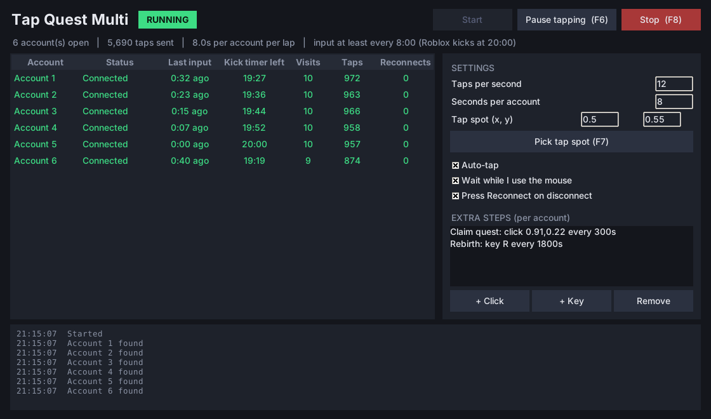
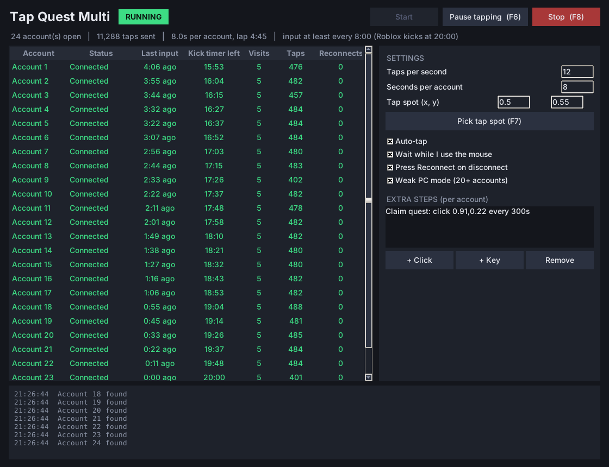

# Tap Quest Multi (v5.5)

Multi-account macro for Tap Quest Sim on a Windows PC. It cycles through every open
Roblox window, taps, runs your extra steps (claim quest, rebirth...), and makes sure
no account sits idle long enough for Roblox's 20-minute kick.

## Use it

1. Install Python 3.10+ from python.org (tick "Add python.exe to PATH"). Nothing else to install.
2. Open all your Roblox accounts and join the game on each.
3. Double-click **Start Macro.bat**.
4. Click **Pick tap spot (F7)**, hover the mouse where the macro should tap inside any
   Roblox window, and press **F7**. Spots are saved as a fraction of the window, so they
   work on every account as long as the windows show the same layout.
5. Optional: tick **Auto egg** to press R about once a second on each account while the
   macro is on it (stand next to the egg first; `egg_key` and `egg_every_s` in
   `settings.json` change the key and speed). Set **Round every** to e.g. 30 to visit each
   account once every 30 seconds (click, press R, move on) and leave the PC alone in
   between; 0 means go round nonstop. **+ Click** / **+ Key** add timed steps that run on every account.
6. Press **Start**.

| Key | Does |
| --- | --- |
| F6 | Pause/resume tapping. Paused accounts are still kept connected. |
| F8 | Stop everything. Accounts are no longer kept connected. |
| F7 | Save a spot (only while picking one). |

## How it keeps accounts connected

- The account that has gone longest without input is always visited next.
- Every account gets input at least every 8 minutes. Time per account shrinks automatically
  when you open more accounts so a full lap always fits.
- When you move the mouse, tapping waits. If an account reaches 8 minutes meanwhile, the
  macro switches to it for about a second, sends one harmless key press, and hands your
  window and mouse position back.
- Input is only sent after confirming the right Roblox window is in front, so it never
  types or clicks into your other apps.
- If a window can't be brought to the front it is retried with a back-off and the other
  accounts carry on. You get a sound alert at 15 minutes idle, before the kick.
- If the grey "Disconnected" pop-up is showing, it presses Reconnect.
- Windows is stopped from sleeping or locking the screen while the macro runs.
- A closed/crashed Roblox window raises an alert; newly opened windows are picked up
  automatically.

## Weak PC mode (20+ accounts on a slow computer)

Tick **Weak PC mode** before pressing Start. It:

- keeps only the account being tapped on screen and minimises the rest, so the PC draws
  one game instead of twenty;
- shrinks every Roblox window to 480x360 (`weak_window` in `settings.json`), which cuts
  GPU and memory use a lot;
- power saver: every account that is waiting its turn is put in Windows efficiency mode
  and hard-capped at 4% of the CPU (`weak_cpu_cap_pct`), and is released the moment the
  macro switches to it. 20 waiting accounts can use at most about 80% between them, and
  in practice far less. Stop lifts all caps;
- sets Roblox to below-normal CPU priority and the macro above, so taps stay on time;
- every 5 minutes asks Windows to move idle accounts' memory out of RAM
  (`weak_trim_s` in `settings.json`, 0 turns it off);
- waits up to 10 seconds for a slow window to appear instead of giving up;
- measures how long this PC takes to switch accounts and sizes each lap to fit;
- sends the keep-alive key twice, in case lag swallows one;
- redraws the app's own table less often;
- alerts you if the PC is too slow to keep that many accounts safe.

Also do these by hand in each Roblox window, they matter more than anything the macro
can do: graphics quality 1, lowest frame-rate cap, small window.

### ASUS ROG Ally (Z1 Extreme) with 20 accounts

The shipped `settings.json` is set up for this: Weak PC mode on, small windows, memory
trim every 2 minutes, 8 taps a second, one round every 30 seconds.

Memory is the limit on this device, not the macro. 20 Roblox clients need roughly
8-14 GB, and the Ally's GPU takes its share out of the same 16 GB (24 GB on the Ally X).
Do these once, or it will likely run out:

- Armoury Crate > Settings > Performance > "Memory Assigned to GPU": set the lowest
  option, then restart. This hands several GB back to Windows.
- Plug in and use Turbo mode.
- Windows > System > About > Advanced system settings > Performance > Virtual memory:
  set the page file to at least 24000 MB.
- In each Roblox: graphics quality 1, lowest frame-rate cap.
- Close everything else (browser, Discord, Steam).
- Start with 10 accounts, watch Task Manager's memory, then add a few at a time.

A game cannot run on zero power: the client must keep talking to the server or Roblox
drops it. If accounts start disconnecting with "connection lost", raise
`weak_cpu_cap_pct` (try 8). If you force-close the macro instead of pressing Stop, the
caps stay on until you restart those Roblox windows.

None of this was tested on an Ally. If memory hits 95%+, that is the device's ceiling.

## What was tested, and what wasn't

Tested here (35 automated tests, `Run Tests.bat` runs them on your PC):

- 24-hour simulated sessions with 1 to 60 accounts: zero idle kicks.
- 24-hour sessions with everything going wrong at once (focus failing 25% of the time,
  network drops, stuck windows, a person using the PC): zero idle kicks, zero input sent
  to the wrong window, every network drop reconnected.
- 72-hour run with 12 accounts: 0 kicks, longest gap without input 9.4 min.
- Simulated bad PC (windows take seconds to appear, 3%+ of input swallowed, freezes of up
  to 6 seconds): 24 hours with 20, 30, 45 and 60 accounts, and 72 hours with 30 accounts
  plus a person using the PC: zero idle kicks. Longest gap without input 12.9 min.
- Paused mode, tapping switched off, crashes, stop/pause keys, bad settings, the app window.

Not tested (this was built without access to a Windows PC or Roblox):

- The Windows layer in `tapquest/win.py` (finding windows, focusing them, sending clicks).
  Do a short supervised run first.
- Weak PC mode's Windows calls (minimise, priority, memory trim). The simulated bad PC
  is my model of lag, not a measurement of yours. If a tweak fails it is skipped and
  logged; the macro keeps running.
- How many Roblox clients your PC can actually hold open. The macro can't add RAM.
- The disconnect pop-up detector. Its colour and Reconnect button position
  (`reconnect_color`, `reconnect_dx`, `reconnect_dy` in `settings.json`) are best guesses
  and may need adjusting. If it misbehaves, untick "Press Reconnect on disconnect".

Limits to know about:

- Roblox only accepts input in the focused window, so the macro takes the mouse while it
  taps. Use F6 when you want the PC to yourself.
- It can't relaunch a Roblox window that closed, or log back in.
- Macros can be against a game's rules; use it on your own accounts at your own risk.

## Files

- `tapquest/engine.py` - scheduling and safety rules
- `tapquest/win.py` - Windows input and window handling
- `tapquest/sim.py` - simulated PC used by the tests and `--demo`
- `tapquest/gui.py` - the app window
- `settings.json` - all settings (the app saves it when you press Start)

`python -m tapquest --demo` shows the app with simulated accounts.
`python -m tapquest --soak 24 --accounts 30 --slow-pc` runs a simulated endurance test.
